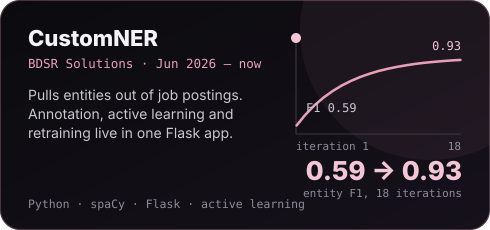
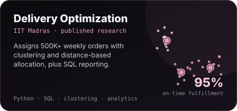
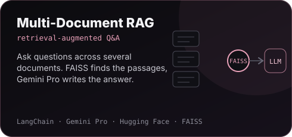
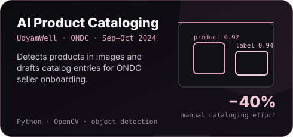

 

Hi, I'm Sreeja. I'm doing my MS in Data Science, Analytics and Engineering at [Arizona State University](https://www.asu.edu/) (May 2027, 4.0 GPA). Before that I did a B.Tech in AI & Data Science in Hyderabad, where I finished as the [Best Outgoing Student](https://drive.google.com/file/d/1NDh1yyRwMtNftQhL-cTiECLDM1uoQr0p/view?usp=sharing) of the program.

Looking back at what I've built, there's a pattern: it usually starts with messy text or messy operations data. Job postings, customer complaints, delivery orders, fund mandates. What I enjoy most is the last step, where the model disappears behind something a non-technical team can actually use. At IIT Madras that was an email classifier for courier operations. At BDSR it's CustomNER, a tool where reviewing the model's predictions is what retrains it.

**Right now**

- 🛠️ AI Engineer and Python Full Stack intern at BDSR Solutions
- 📚 Grading graduate Information Systems assignments at ASU
- ♟️ Building [**MandateIQ**](https://github.com/sreejasun/MandateIQ), a multi-agent system that reviews fund nominations (below)

I'm looking for software engineering, AI/ML and data science roles.

**[MandateIQ](https://github.com/sreejasun/MandateIQ)** reviews one fund at a time against an investment mandate. A Proponent agent builds the case for approval and a Challenger agent attacks it, for up to three rounds. Every claim has to cite an evidence ledger, and a hallucination firewall blocks anything that cites missing or misquoted evidence. Policy, cost and suitability rules run next to the agents, and a Trust Score decides whether a case is finalized, sent back for rework, or handed to a person. One rule it never bends: a high Trust Score cannot override a failed control.

Under the hood it's a FastAPI + SQLite backend with a React/TypeScript interface. AWS Bedrock is the main model provider, through the Converse API with a bounded tool-use loop for each agent. There's also a Groq adapter for when I don't have AWS access, and a mock provider so the whole test suite runs offline. It's an educational prototype on synthetic data, not investment advice.

<table>
<tr>
<td width="50%"> <b>Committee:</b> the debate, round by round. Withdrawn claims are struck through.</td>
<td width="50%"> <b>Trust and governance:</b> how the score was built, and every rule that fired.</td>
</tr>
</table>

👉 **[Code, architecture and setup on GitHub →](https://github.com/sreejasun/MandateIQ)**

<table>
<tr>
<td width="50%"></td>
<td width="50%"></td>
</tr>
<tr>
<td width="50%"></td>
<td width="50%"></td>
</tr>
</table>

- **CustomNER** (BDSR Solutions): a Python and spaCy pipeline for pulling structured entities out of unstructured job postings, wrapped in a Flask human-in-the-loop app that combines annotation, active learning and iterative retraining. Entity F1 went from 0.59 to 0.93 over 18 iterations while the manual labeling effort dropped. It's an internal tool, so there's no public repo.
- **Delivery optimization** (IIT Madras): a dynamic delivery-assignment system for 500K+ weekly orders, using clustering and distance-based allocation with SQL integration for reporting. It reached 95% on-time fulfillment. Supervised by Prof. C. Rajendran and Dr. G. Viswanath (TCS) at DoMS, IIT Madras. [Read the paper →](https://drive.google.com/file/d/1v_k7RDhcDrZIFxkG2X88pN_TKJix34Hd/view?usp=drive_link)
- **Multi-document RAG**: a question-answering pipeline over several documents, using Hugging Face embeddings and FAISS for retrieval and Gemini Pro (through LangChain) to write the answer.
- **AI product cataloging** (UdyamWell, on the ONDC network): object detection plus description generation to automate product images in the onboarding flow, at 92% detection accuracy. [Details →](https://drive.google.com/file/d/1lOrfOd4O5sxYROFxYkp2dERLhaXOOSNO/view?usp=drive_link)

| When | Role | What I did |
|---|---|---|
| **Jun 2026 – now** | AI Engineer, Python Full Stack Intern · BDSR Solutions LLP | Designed and deployed CustomNER from scratch, then built the Flask human-in-the-loop app around it. |
| **Mar 2026 – now** | Information Systems Grader · [Arizona State University](https://www.asu.edu/) | Grading graduate-level work in Python, information systems and analytics, with technical feedback students can act on. |
| **Jun 2024 – Apr 2025** | ML Research Intern · [IIT Madras](https://www.iitm.ac.in/) | NLP pipeline over 1,000+ customer-feedback records scraped from public sites, to find operational patterns in courier services. A two-level classifier that sorts feedback and routes it into 6 departments. A real-time email classification app for non-technical ops teams. |
| **Sep – Oct 2024** | AI Developer Intern · [UdyamWell](https://drive.google.com/file/d/1lOrfOd4O5sxYROFxYkp2dERLhaXOOSNO/view?usp=drive_link) (ONDC) | Computer-vision cataloging system, integrated into ONDC product onboarding: 92% detection accuracy, 40% less manual cataloging. |

- 📄 **[GenAI-Driven Intelligent Email Ticketing: An End-to-End Architecture for Automated Sentiment-Aware Customer Support](https://link.springer.com/chapter/10.1007/978-3-032-22114-8_29)**. ICACECS 2025, *Smart Innovation, Systems and Technologies* vol. 488, Springer. ([DOI](https://doi.org/10.1007/978-3-032-22114-8_29))
- 📄 **[Optimizing Delivery Operations in Dynamic Urban Environments: A Comprehensive Model](https://drive.google.com/file/d/1v_k7RDhcDrZIFxkG2X88pN_TKJix34Hd/view?usp=drive_link)**. *Sustainable Paradigms in Operations and Supply Chain Management*.

More on [Google Scholar](https://scholar.google.com/citations?hl=en&user=s_hU8_UAAAAJ).

**Languages** &nbsp;  &nbsp; SQL

**AI / ML** &nbsp; 
     

**Backend & cloud** &nbsp; 

**Data** &nbsp;       

- 🎓 **[Arizona State University](https://www.asu.edu/)**: MS in Data Science, Analytics and Engineering (Computing and Decision Analytics), GPA 4.0/4.0, May 2027
- 🎓 **CMR College of Engineering and Technology**: B.Tech in AI & Data Science (GPA 9.16/10) with a minor in Computer Science Engineering, Cyber Security (9.5/10), May 2025. [Best Outgoing Student](https://drive.google.com/file/d/1NDh1yyRwMtNftQhL-cTiECLDM1uoQr0p/view?usp=sharing) and one of the [first-year academic toppers](https://drive.google.com/file/d/16-Z9SnqzkgTgc2GrFDG9Rm_S8_B7JZvX/view?usp=sharing)
- 📜 [Generative AI with DeepLearning.AI and AWS](https://drive.google.com/file/d/1wrTWFeftnjDZos39qpECiu2liryaChHT/view?usp=sharing) (Coursera, 2024)
- 📜 [AI Agents course by Hugging Face](https://drive.google.com/drive/folders/1ekVstwvd5-r92gxp9pOPnrz4_lL3cUni?usp=sharing) (2025)

  

<picture>
  <source media="(prefers-color-scheme: dark)" srcset="https://raw.githubusercontent.com/sreejasun/sreejasun/output/github-snake-dark.svg">
  
</picture>

 

If something here fits a role you're hiring for, I'd love to hear from you: [sunkeswaramsreeja@gmail.com](mailto:sunkeswaramsreeja@gmail.com)

